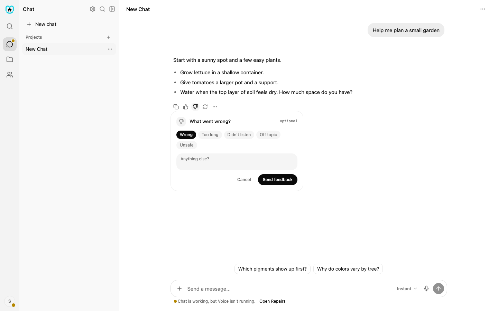
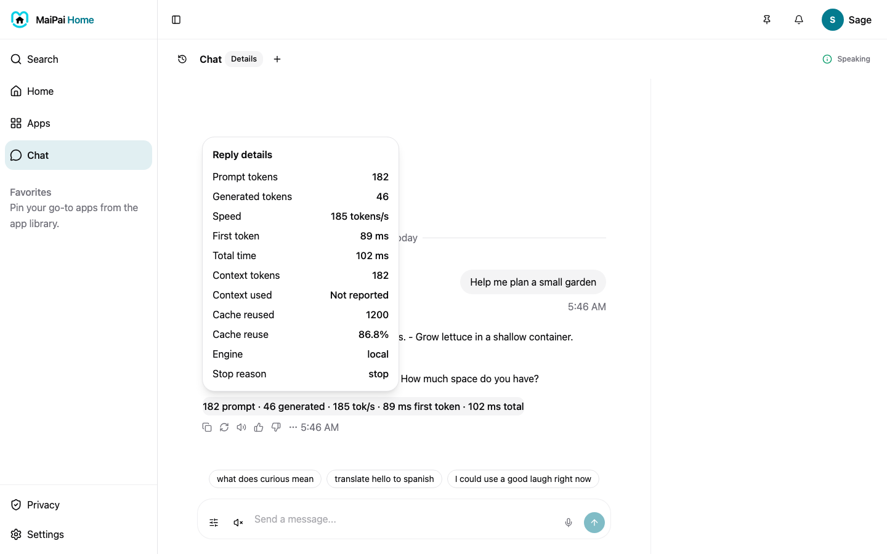
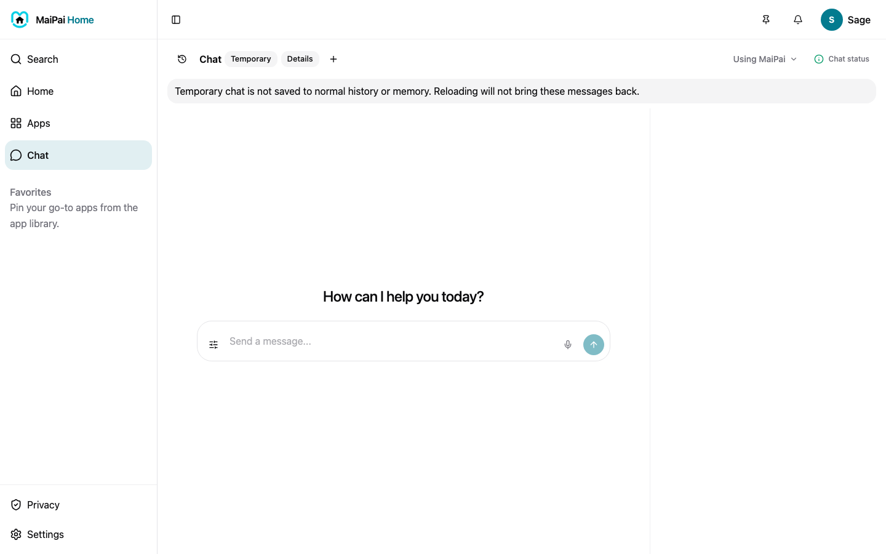
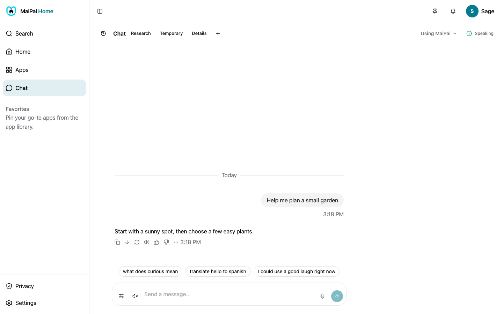

Chat is where you talk to MaiPai, by typing or by voice.

## Send a message

1. Tap the message box at the bottom and type your question.
2. Tap the arrow button, or press Enter, to send it.

MaiPai's answer appears below your message. Chat follows the newest text while a reply is coming in. If you scroll up, tap the down arrow to return to the latest message.

The message box takes focus when you open Chat and when a menu closes, so you can start typing right away.

Each chat gets a title from your first message at once. Soon after, Home replaces it with a short title the fast helper model writes. A chat that only says hello stays **New chat** until there is something to title. You do not need to wait for the reply to finish.

When you open Chat, the empty chat shows one of ten pictures. The picture changes from one visit to the next.

## Thinking, and what the words mean

Some models think before they answer. Home keeps that thinking folded away by default. While the model thinks you see a calm label with a plain word that changes every 10 to 14 seconds. When it is done, the label reads **Thought for 12s**, with the number of seconds. Tap it to read the reasoning. Home remembers whether you like it open or closed.

If you use reduced motion on your device, the label stays **Thinking** and does not change.

A model like Muse Glimmer thinks on every turn. For those models the message box shows a short **Thinking** badge instead of a mode picker. Hover or focus the badge to see why. An Instant mode for these models is planned, but it is not available yet.

## What MaiPai can look up

Ask MaiPai to look something up and you get a real answer, not a guess. Just ask it directly, for example:

- "What's the weather in Seattle?"
- "What does curious mean?"
- "Who directed Cobra?"
- "Search the web for tonight's game score"

Weather, word meanings, trivia, and film lookups work right away. Web search is on for adults when Home's search is ready. It uses your own SearXNG if one is set up, and DuckDuckGo otherwise. Teens and children use the Library and your own SearXNG unless an owner or admin allows more. See [Set up web search](web-search.md). When you search, MaiPai reads a few of the pages it finds, so the answer comes from what they say. If a lookup finds nothing, Home says what is missing and what to do. It never leaves you with an empty reply. For the weather, see [Weather](weather.md).

See the [Privacy](privacy.md) page for what each one sends, and to whom.

Some answers include small numbered markers such as **[1]** in the reply. Tap a marker to open the matching source. Choose **Sources** under the reply to see its source list.

## See what MaiPai can do

Open **Settings**, **Chat and AI**, then the **Skills** tab to see the skills MaiPai has, like the weather, timers and reminders. Each one says **Used in chat** when MaiPai can use it in your chats today. Skills added to your home from the MaiPai Catalog show up under **Added to this home**. Children do not have this section.

## Save a draft

If you type in a saved chat and leave before sending, Chat keeps your draft on this device. Open that chat again and choose **Restore** to put the text back, or **Discard** to remove it. Sending the message clears the draft. Drafts are not saved in Incognito.

## If the AI is starting

If you see **Starting your AI**, wait for it to finish. You can type while it starts. The send button waits and reads **Getting ready, one moment** while the AI warms up, then works again. Home loads the chat model when it starts, so the first reply after a restart is quicker than it used to be.

## If the connection drops

Chat shows a banner when it is reconnecting, when the reply resumes, or when the connection is dropped. If the reply does not resume, choose **Retry** in the banner.

If a reply fails, one short line appears under it. Choose **Retry** to try the reply again. Admins can open **Error details** for more information.

## If chat is paused

Sometimes MaiPai's AI stops for a while, for example while the computer restarts it. A short line under the message box says chat is paused, and the top bar shows **Chat paused**. You can keep typing. The send button waits until chat is back, and your message stays in the box. If you look after the household, the line has an **Open Repairs** link that shows what stopped.

## Talk instead of type

Tap the microphone icon next to the message box and start speaking. MaiPai listens, turns your words into text, and sends it once you stop talking. The first time, your browser asks for the microphone. If it says no, Home shows help for your browser. See [Talking to Home](voice.md).

You can talk over Home or tap Stop, and it will stop speaking and listen.

## Wake word (experimental)

An adult can turn on the wake-word listener for one device. Open **Settings**, **Voice and robot**, then the **This device** tab, and turn on **Wake word**. The tab shows up once the wake word files are installed. Saying the wake word opens a voice conversation. Home stops listening by itself if nobody speaks for a few seconds.

## Chat options

The message box grows as you type. When your model can switch, choose how it answers: **Instant** for quick answers, **Thinking** for slower answers that are only for you, or **Max** for the strongest answers. Models that always think show the **Thinking** badge instead (see above).

**Max** is for adults an admin allowed to use it. It asks **Use Max for this message?** and says it slows everyone down, because Home gives the big model most of the computer. It takes about a minute to start, and Home hands it back soon after the answer. See [Max chat](coding-mode.md).

Type **@** and a companion's name to ask that companion one question. The chat's own companion stays the same.

After some replies, small suggestion buttons offer a next question. Tap one to send it. When MaiPai needs your OK before it acts, or needs a few details from you, a card appears under its reply. Fill it in or choose the button on the card.

## More on a message

Each of MaiPai's replies has a few small buttons under it:

- **Copy** the text
- **Refresh** to get a new answer
- **Listen**, to have MaiPai read the answer out loud
- **More**, for extra options like remembering or forgetting that exchange, and **Details** (see below)

## Rate a reply

Under each of MaiPai's replies, tap the **thumbs up** or **thumbs down** button. A thumbs down opens a small **What went wrong?** form. Pick any reasons that fit, add a note if you like, and tap **Send feedback**. It is optional: your thumbs down counts even if you skip it. Your note is private. Only you can read it back, and it is deleted with the chat. Children rate with the thumbs only.

A rating only labels the reply for the household. It does not change the answer or start a new one. MaiPai and the hub use those labels to see which kinds of replies land well.

## See what MaiPai remembered

When MaiPai saves something from a reply, the saved fact shows as a small chip under that reply. Tap the **x** on a chip to forget it. To save a reply yourself, open **More** under it and tap **Remember this**. Children do not see chips or Remember this, and Incognito never remembers anything.

## When MaiPai stops a reply

If MaiPai stops a reply partway because it wasn't safe to finish, one short sentence under the reply says so and what to try instead. If the conversation sounds like someone might be in crisis, MaiPai shows **Support is available** beside the reply instead, with links to call, text or chat with the 988 Suicide & Crisis Lifeline. Nothing is hidden or blocked, and everyone in the household sees the same help.

## See the reply stats

Open **More** under a reply and choose **Details**. A small line appears with the token counts and the timing, for example how long the first token took and how fast the reply streamed. Tap the line to open the full set of numbers. Choose **Details** again to hide it. Children do not see the stats at all.

## Attach a document or picture

Tap the **+** button next to the message box. The menu opens above the plus, one short row for each choice, such as **Add photos and files**, **Take a photo**, **Create image**, **Search the web** and **Start a voice conversation**. Choose a document or a picture from your device, and it appears as a small tile above the box. On a phone, **Take a photo** opens the camera. You can also paste a picture, or drag a file anywhere onto the chat page. Tap the **x** on a tile to take it back out. Type your question, then send. MaiPai reads a document and answers about it.

Pictures you send show as small thumbnails above your message. Tap one to see it full size. On computers with 32 GB of memory or more, the chat model (Muse Glimmer) looks at the picture and answers about what is in it. Big pictures are shrunk to 2000 pixels on the long side first. iPhone photos in the HEIC format work too. On a smaller computer the model cannot see pictures. The **+** menu then says why pictures are off, and MaiPai tells you it can't look at the picture. You can add up to 4 pictures to a message, each up to 10 MB.

Pictures are cleaned before they are saved: the hidden details a camera adds (like where the photo was taken) are removed. Children cannot send pictures until a parent turns on **Send photos in chat** for them. Teens and adults can send pictures from the start.

The file stays on the hub, attached to that conversation, and it is deleted on the same schedule as the conversation. A child's picture follows the same rules as everything else they see: the answer stays within the child band, and the source links stay hidden.

Your own messages have buttons too. Hover or tap one to see **Copy**, **Edit**, and a brain icon for **Remember this**. Editing sends a new version and gets a fresh reply. MaiPai keeps both the old and new versions. A small **1 / 2** switcher lets you flip between them, even after you reload the page.

Did MaiPai save something you said? A **Memory updated** chip shows up under its reply. Tap the chip to see what was saved, on the [Memory](memory.md) page.

## Pictures Home makes

Adults can ask chat to draw a picture or make a short video, and to animate a picture. See [Pictures](pictures.md) and [Videos](videos.md). Adults can also ask for a song and change it by asking. See [Songs](songs.md).

## Start a new conversation

Tap **New chat** beside the chat list to start fresh. A new chat is saved when you send its first message.

## Long chats

A chat never stops working because it got long. As it grows, MaiPai keeps short notes about the earlier part and keeps the newest messages word for word. Rarely, a very long message will not fit beside those notes. MaiPai then says so and offers a fresh start: tap **New chat**, and the new chat brings the notes along. It uses them from your next message there. Talking to MaiPai out loud never gets this offer; it just answers.

## Projects

A project keeps chats about one thing together, like a garden plan or a school science fair. In the chat list, choose **+** next to **Projects**, type a name and press Enter. To put a chat in a project, choose **...** on the chat, then **Move to project**, or drag the chat onto the project. Choose a project to open or close it. Its **...** menu starts a **New chat in project**, renames it or deletes it. Deleting a project keeps its chats. A child's projects are made by a parent. Incognito chats are never in a project.

## Your conversation history

Use the chat list beside the conversation to find a chat. Type in **Search chats** to search the list. On a narrow screen, open the chat list from its button. Use the collapse button to hide the list and make more room for the conversation. Reopen it from the same button.

Open **More options** beside a chat to rename, pin, archive or delete it. The menu at the top of a chat has the same choices: **Rename**, **Pin** or **Unpin**, **Archive** and **Delete**, then **Read replies aloud** below a line. Deleting asks you to confirm first.

Owners and admins can also view another household member's conversations. This helps with parental oversight.

## Choose the companion

A companion picker sits in the chat header. Choose a companion and a line says who will answer next. The choice stays with that chat. See [Companions](companions.md).

## Keyboard shortcuts

On a computer, these work in Chat. Cmd is for Mac and Ctrl is for Windows.

- **New chat**: Cmd or Ctrl + Shift + O
- **Focus composer**: Shift + Esc
- **Stop reply**: Esc
- **Command palette**: Cmd or Ctrl + K
- **Toggle sidebar**: Cmd or Ctrl + B

Open **Settings**, **Chat and AI**, then the **Keyboard shortcuts** tab to see the same list.

## Incognito

Turn on **Incognito** from your profile menu before you send a message. An Incognito chat is temporary and is not saved with your regular conversations. It has no saved title, cannot be pinned, and does not keep drafts. When you turn Incognito off, its chats are cleared.

## Continue a cut-off reply

If a reply cut off early, a **Continue** button appears under it. Tap it and MaiPai picks up where it stopped. The original reply stays the same. One tap makes one more call, then it's done.

## Something not working?

| What you see | Why | What to do |
|---|---|---|
| "Something went wrong" under a reply, right after Home restarted or updated | The AI engine was restarting while you asked | Wait a minute, then press **Retry**. If it keeps happening, open **Repairs** |
| "Getting ready, one moment" and Send waits | The AI is warming up | Wait. Your message stays in the box |
| "Chat paused" | The AI engine stopped for a while | Keep typing. An owner or admin opens **Repairs** |
| A lookup says what is missing | Search or weather has no source or place | Follow the line it gives. See [Set up web search](web-search.md) and [Weather](weather.md) |
| The + menu says pictures are off | This computer's chat model cannot read pictures (under 32 GB), or you are a child without permission | Ask an owner or admin, or send a document instead |
| A picture will not attach | Over 10 MB, more than 4, or not a picture file | Pick fewer or smaller pictures. iPhone HEIC photos work |
| The microphone does not work | Browser or Mac permission | See [Talking to Home](voice.md) |

## Still need help?

If Chat won't send a message or load a reply, see [Fix a problem](fix-a-problem.md).

## What Home will not do, and what it will talk about

As an adult you can ask Home about films, news, true crime, fiction, health and personal advice, including difficult subjects such as child abuse, without it being stopped for the topic. Home will not write, describe or make sexual content involving a child, and it will not make a picture or video of one, whatever the wording or the framing. A teen's and a child's chats follow stricter rules.
