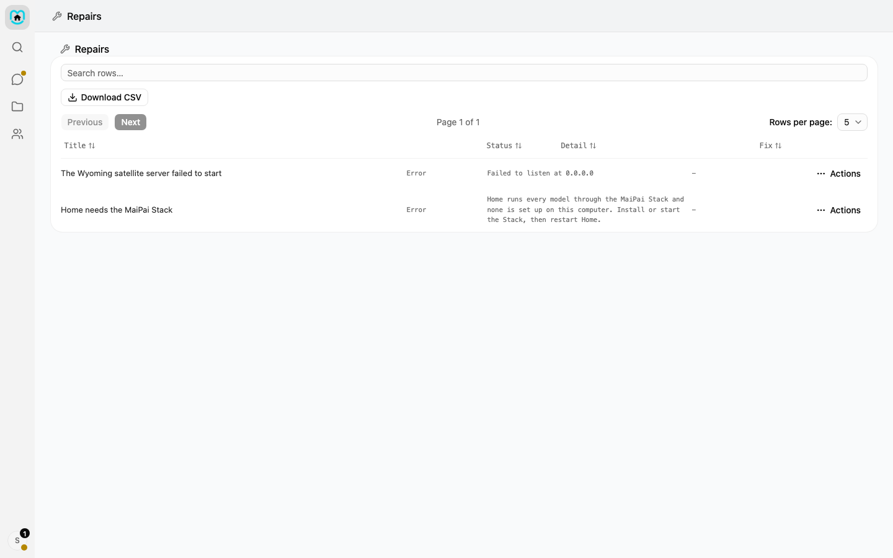

## Start here

Open **Settings**, then **Backups, storage and updates**, then the **Maintenance** tab, and choose **Repairs**. Owners and admins also see a **Repairs** button on the Home screen. MaiPai lists anything that needs attention, its status, and the available action. This is the fastest way to find out what's wrong.

On a Mac, the **Status** page also shows whether its self-check is working. If the Mac restarted itself, open Status to see the latest check.

Owners and admins can choose **Check my computers again** to refresh the computer checks. The results appear here in Health. Choose **Run setup again** to review the AI computer, file location, checks, and plan. You can change the AI computer choice there. The file location and plan screens are read only until those choices are ready to change. Leaving the review without a change saves nothing.

## If MaiPai won't load at all

If your device shows a page saying "Home is restarting or updating," the hub is off for a minute, or your device is away from your home network. The page checks every few seconds and opens Home by itself when the hub answers. If you are away from home, reconnect to your home Wi-Fi.

## If a reply says "Something went wrong"

If it shows up right after an update or a restart, the AI engine was probably still starting. Wait a minute and press **Retry**. If it comes back, open Repairs.

## If it says "Getting ready" or a picture is waiting

"Getting ready, one moment" means the AI is warming up. It clears by itself. See [Pictures](pictures.md) and [Videos](videos.md).

## Why is my picture, video or song slow?

If the card says "Waiting for its turn," another job is ahead of yours, or someone is chatting or talking to Home. Your job starts by itself, or you can tap **Cancel**. Home makes one big job at a time, so your job may wait for another picture, video or song.

## If MaiPai looks out of date

MaiPai updates itself the next time you open it. If a page still looks old after an update, reload it once. If it still looks old, close every MaiPai tab, then open it again. You will not lose anything; your chats and settings are saved on the hub, not in the browser.

## If Chat won't send a message or answer

- Check Repairs first. MaiPai may have already spotted the problem.
- Make sure an AI model is set up. Open **Settings**, then **AI and models**, and confirm one is selected.
- Try reloading the page.

## If voice input doesn't work

- Make sure your browser has permission to use your microphone. If Home shows a help box when you start a voice conversation, follow it, then press **Try again**. See [Talking to Home](voice.md).
- If the connection to your hub drops, check that the hub is on, then tap the waveform to start again.
- If Home says its listening engine is not running, type your message instead, or open Repairs to check it. Ask an owner or admin if you cannot open Repairs.
- If Home cannot speak a reply, read it on screen. Voice will try again on your next question.
- Saying the wake word opens a voice conversation. Home stops listening by itself if nobody speaks for a few seconds.

## If you can't sign in

- Double check your PIN or password. A PIN shows as one box per digit, and Home signs you in when the last box is full.
- After 5 wrong tries the account locks, first for 30 seconds, then longer each time. A countdown shows. Wait for it to end, then try the right code. See [Sign in](sign-in.md).
- The lock is only for you on that device. Other people can still sign in, and you can still sign in on another device.
- If two-step sign-in is on, Home asks for the 6-digit code from your authenticator app after your PIN. A code is good for 30 seconds, so wait for a fresh one. If the code step says the sign-in expired, pick your name and start again.
- If Home says "This address is not one Home answers to", you opened it by an address it does not use. Open Home by its own address. An owner or admin finds it in **Settings**, **Advanced**, **Network and access**.
- Ask an owner or admin to check your account. They can do this under **Settings**, **Household and people**, **People**, then **Users**.
- If you're signed in on another device that's misbehaving, open **Settings**, then **Profile and sign-in**. Under **Signed-in sessions**, choose **Sign out** next to that device.

## If a setting won't save

- Check your internet connection to the hub itself. MaiPai still needs to reach your own server, even though nothing leaves your house.
- Only an owner or admin can change some settings. If a field looks disabled, that's likely why.
- If Home refuses a change, it says what went wrong and what to do, and the setting keeps its old value. Nothing is half saved. Fix what the message names, then try again.
- Messages show in the language you picked. See [Language](language.md).

## Still stuck?

If Repairs shows nothing wrong, or none of the above helped, the MaiPai community can help you dig deeper. Check the developer documentation for how to reach us.
