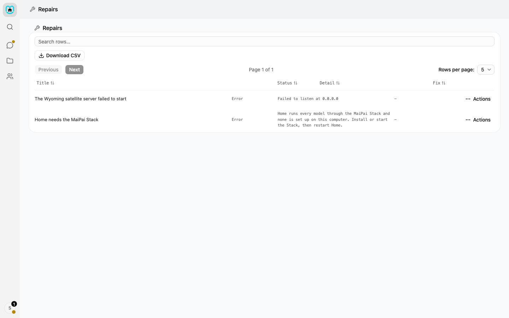

## Start here

Open **Settings**, then **Repairs** under Manage. MaiPai lists anything that needs attention, its status, and the available action. This is the fastest way to find out what's wrong.

Owners and admins can choose **Check my computers again** to refresh the computer checks. The results appear here in Health. Choose **Run setup again** to review the AI computer, file location, checks, and plan. You can change the AI computer choice there. The file location and plan screens are read only until those choices are ready to change. Leaving the review without a change saves nothing.

## If MaiPai won't load at all

If your device shows a plain dark screen saying "Can't reach MaiPai right now," it isn't connected to your home network - the hub itself may be off, or you're away from home. Nothing works without that connection, since everything MaiPai does lives on your own hub. Reconnect to your home Wi-Fi, or try again once you're back in range.

## If MaiPai looks out of date

MaiPai updates itself the next time you open it. If a page still looks old after an update, reload it once. If it still looks old, close every MaiPai tab, then open it again. You will not lose anything; your chats and settings are saved on the hub, not in the browser.

## If Chat won't send a message or answer

- Check Repairs first. MaiPai may have already spotted the problem.
- Make sure an AI model is set up. Open **Settings**, then **AI models**, and confirm one is selected.
- Try reloading the page.

## If voice input doesn't work

- Make sure your browser has permission to use your microphone.
- If the connection to your hub drops, check that the hub is on, then tap the waveform to start again.
- If Home says its listening engine is not running, type your message instead, or open Repairs to check it. Ask an owner or admin if you cannot open Repairs.
- If Home cannot speak a reply, read it on screen. Voice will try again on your next question.
- Saying the wake word opens a voice conversation. Home stops listening by itself if nobody speaks for a few seconds.

## If you can't sign in

- Double check your PIN or password.
- Ask an owner or admin to check your account. They can do this under **Settings** > **Users**, or reset your PIN there.
- If you're signed in on another device that's misbehaving, open **Settings**, then **Devices & sessions** (under Me), and sign that device out.

## If a setting won't save

- Check your internet connection to the hub itself. MaiPai still needs to reach your own server, even though nothing leaves your house.
- Only an owner or admin can change some settings. If a field looks disabled, that's likely why.

## Still stuck?

If Repairs shows nothing wrong, or none of the above helped, the MaiPai community can help you dig deeper. Check the developer documentation for how to reach us.
