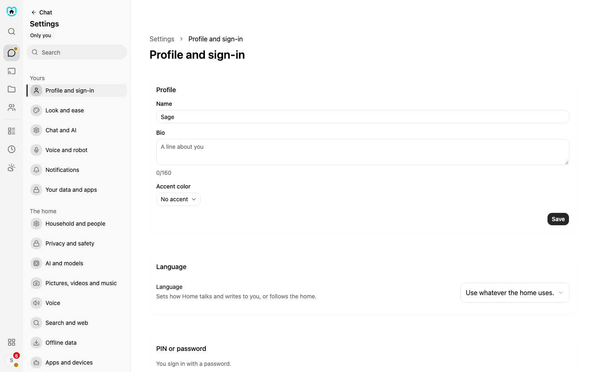
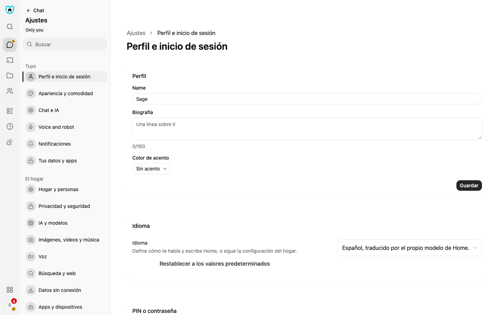
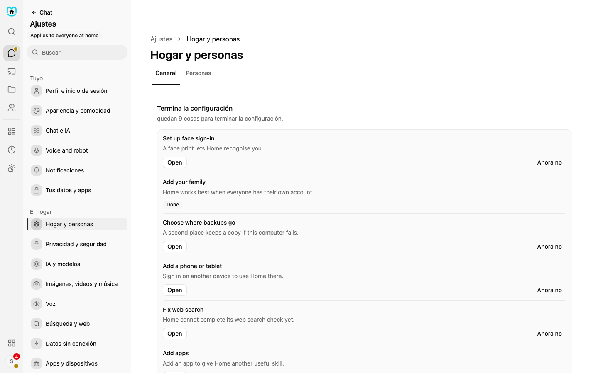
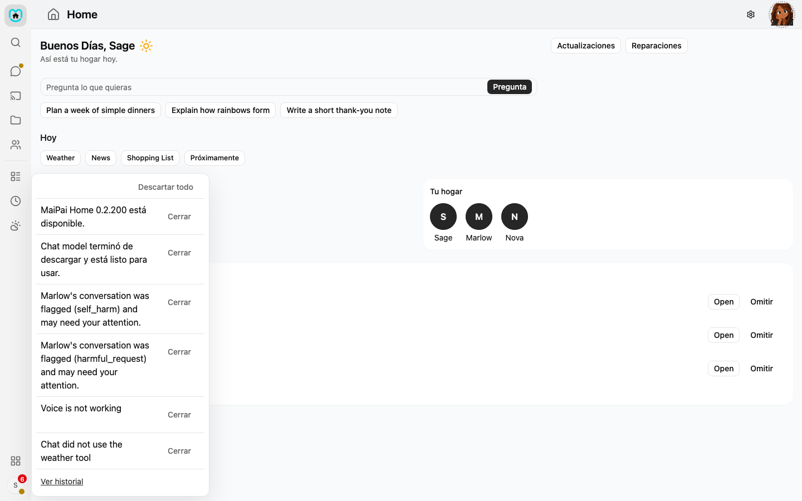
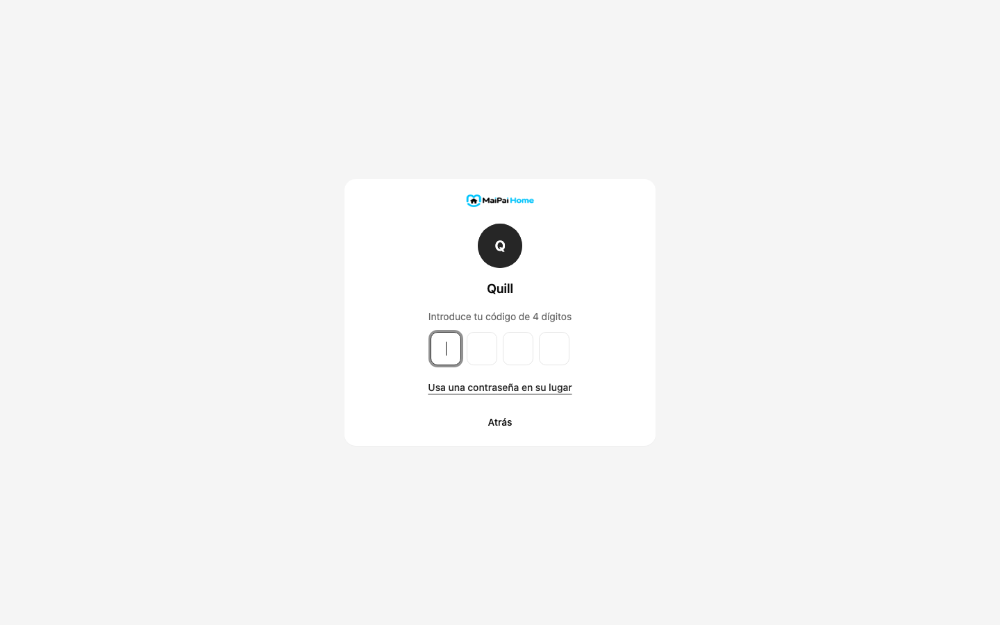

# Language

Home can show its buttons, menus and messages in English or in Spanish. Each person picks their own language, so one person can read Spanish while another reads English on the same Home.

These choices are there today:

- **English (United States)**
- **English (United Kingdom)**
- **Español**

## Pick your language

1. Open **Settings**, then **Profile and sign-in**.
2. Find the **Language** card.
3. Open the list and pick a language.

The whole screen changes at once. You do not sign out or reload the page. Each language is written in its own words, so you can find yours even if the screen is in a language you do not read.

The first choice in the list is **Same as the home**. It is what you have until you pick something else. If the owner or an admin changes the home's language later, everyone on **Same as the home** moves with it.

When you pick **Español** or **English (United Kingdom)**, a short line appears under the list. It tells you that part of the text was translated by your home's own AI and may read oddly.

## What changes

- Menus, buttons, settings names and help text.
- Messages from Home, such as "Saved" or what to do when something goes wrong.
- The bell and your notification history. New notices show in your language. Older ones may stay in English.
- Telegram notices, if you use Telegram. They come in the language of the person who gets them.
- Dates, times, numbers and units, such as the name of a month or whether a distance is in miles or kilometers.
- The sign-in page. It uses the home's language, because Home does not know who is signing in yet.

## What stays in English, and why

- **What you type, and what the AI writes back.** Home does not tell the AI which language to use. The AI answers in the language you write to it in.
- **Lines written for children and teens, safety and crisis messages, refusals, fixed voice lines and robot speech.** These stay in English until a grown-up has read and approved the translation. A wrong word in these lines could matter more than in a menu, so Home does not use an unreviewed translation for them.
- **Names.** MaiPai, Home and the names of your companions are not translated.

If a line is not translated yet, Home shows it in English. You never see a blank or a code. The menu rail, the search box and the profile menu are in Spanish. A few descriptions inside Settings are still in English while the translation is finished.

## The home's language

An owner or admin sets the home's language. Open **Settings**, then **Household and people**, and find **Language and region** in the **Household** card. It is the language new people start with. It also sets the language of the sign-in page.

The sign-in page does not show each person's own language. Only after you sign in does Home switch to yours.

## If a line reads wrong

Home's own AI wrote the Spanish on this computer. Nothing was sent to another company. It can still make mistakes.

1. Write down the screen and the line that reads wrong.
2. Tell the person who runs your home.

They can fix the line for everyone. The steps are in the Developer guide, on the Language page.

## Something not working?

| What you see | Why | What to do |
|---|---|---|
| The screen is in English after you picked Spanish | A line has no approved Spanish yet | Nothing is broken. Tell the person who runs your home if many lines are in English |
| The sign-in page is in a language you did not pick | The sign-in page uses the home's language | Sign in. Home then switches to your own choice |
| A date or a distance looks unusual | It follows the language you picked | Pick **English (United States)** if you want US dates and miles |
