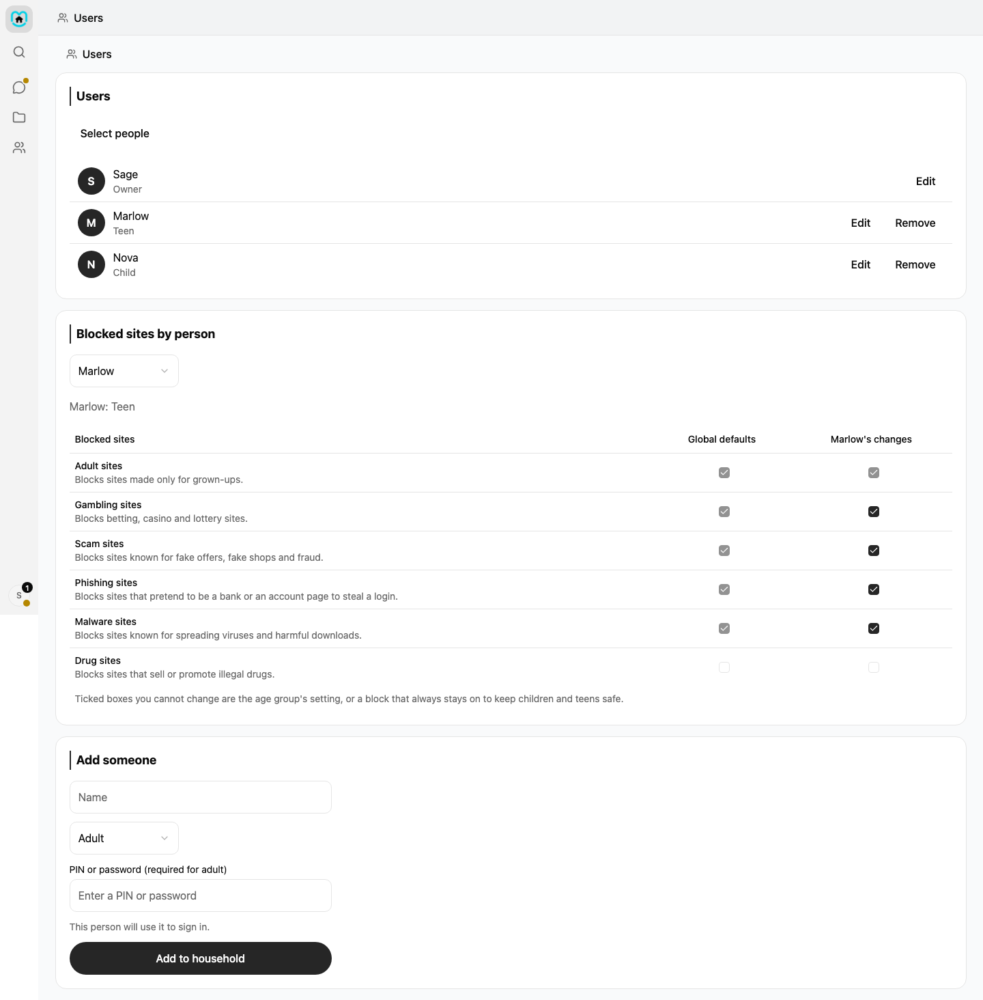

MaiPai keeps a profile for each person in your home. Each profile has its own chats, memories, and access level.

## See who's in your household

Open **Family** in the left rail. The **People** tab shows each person's name, role and a short bio. The roles are Owner, Admin, Adult, Teen, Child and Guest. The **Pets** tab lists pets MaiPai knows about, and the **Bots** tab lists paired robots.

Choose a card to open that person's profile. An owner or admin cannot open a teen's profile. A teen's card shows but does not open.

## Add, edit, or remove someone

Account management lives in Settings, not on the Family page itself.

1. Open **Settings**, then **Household and people**, then the **People** tab, and choose **Users**.
2. To add someone, enter their name under **Add someone**, pick a role, and tap **Add to household**. Adults and owners can also be marked **Admin**. A PIN or password is needed for some roles.
3. To change someone's role or details, tap **Edit** next to their name.
4. To remove someone, tap **Remove** next to their name. You can't remove the owner's own account.

Choose **Child**, **Teen**, or **Adult** for the controls the person needs. Home does not ask for an age or birthdate. A birthday never changes the role. An owner or admin changes it when needed.

Only an owner or admin can add, edit, or remove people. Only the owner can add another owner or admin.

### What happens to their files

When you remove someone, their pictures and other files go too, unless they shared them:

- A file nobody else could see is deleted with them.
- A file they shared with someone stays. The household keeps it, and it counts toward the household's storage, not anyone's own. It is listed as "Household, shared by" their name.
- Before you remove a child, you can tap **Download** to save their files first. A teen's or adult's own files are private, so ask them to save anything they want to keep before you remove them.

## What each role can do

- **Owner**: full access to everything. This includes settings and every account.
- **Admin**: looks after the household, including accounts and settings. An admin cannot change an owner or another admin.
- **Adult**: their own profile, with full chat access.
- **Teen** and **Child**: a restricted profile by default. An adult can unlock more access for them as your household needs it.
- **Guest**: a limited profile. Guests are not shown the family shelf on Home.

## Check in on a child's activity

Owners and admins can read a child's chats and memories. They cannot edit a child's chats. They cannot open a teen's profile.

- Open **Chat** to look at conversations. To see what MaiPai remembers about a child, open **Settings**, **Household and people**, **People**, then **Users**. Under **Memories for** the child's name you can **Export** their memories, **Forget everything**, or archive one memory. See [What MaiPai remembers](memory.md).

If a child's chat worries MaiPai, adults get a note with the child's name. The note never says what was said. It cannot be turned off. Children are told that MaiPai may tell a grown-up.

## Cartoon pictures and videos

Only an owner or admin can change these controls:

- Open **Settings**, **Pictures, videos and music**. **Let children make cartoon pictures and videos** starts on. Children can make cartoons as soon as a picture model is installed.
- On that same page, **Cartoon pictures a child can make each day** starts at 20. Changing one of the child's own cartoons counts as one picture. **Cartoon videos a child can make each day** starts at 5. Set either limit to 0 for none.
- Open **Family**, choose the child, then open **Limits**. **This child can make cartoon pictures and videos** starts on while the home switch is on. Turn it off to stop cartoons for that child. Only owners and admins see **Limits**.

## Still need help?

If someone can't sign in, or you don't see the account options you expect, see [Fix a problem](fix-a-problem.md).
