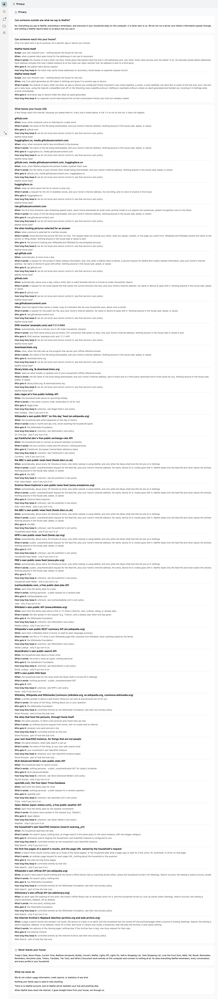

Your conversations, memories, and household profiles stay on this computer. MaiPai does not run a server that your family's information passes through, and nothing reports back to us about how you use it. A feature can send the small piece of information it needs directly to its own service, such as the place in a weather request or the word you want defined. The list below names every connection.

When scene context is used, coarse home or away from your household's own Home Assistant may be used as a soft cue. Home reads it only for the person's own place line, using the entity that person linked in their own settings. Another person's tracker is not read for the turn. This cue can be wrong and does not establish who is present. A person's activity stays theirs.

## See what leaves your house

Open **Settings**, then **Privacy and safety**, and choose **What connects to the internet**. It lists the connections MaiPai can make, including outbound services and inbound token access. For each one, you'll see:

- **When** it happens
- **What it sends**
- **Who receives it**
- **How long they keep it**

For feature lookups and how to clear their saved copies, see [What Home looks up for you](what-home-looks-up.md).

Anything not on this list does not happen. Most entries happen only when an adult chooses a download or turns on an optional feature. During setup Checks, Home opens one empty TCP connection to the set model host. This checks if it answers. Home sends no request or home data. Weather sends the place you ask about when you ask. Home also asks Open-Meteo for weather at your home place about once an hour in the background. Other entries happen when someone asks for a service, such as trivia, a joke, a definition, news, sports, music, web search, or a film or TV lookup. A web search sends the words you searched to the search server you chose. The **Web** tab in the Search box does the same, only when someone presses Enter on it. If DuckDuckGo is on, which it is for adults when no search server is set up, an adult's words also go to DuckDuckGo. Teens and children use it only when an owner or admin allows it. That server asks public search engines for results, so those engines see the words too. They do not get your name or address. Then MaiPai reads up to three of the pages it found, one from each site, so its answer comes from what the pages say. It asks each site for the page the way a web browser would. That site sees a page request from your home's internet address. It does not see your question. Search needs no key and no account. If your search server cannot be reached or finds nothing, and your offline library has no article either, the words you searched go to Wikipedia instead. Wikipedia is run by the Wikimedia Foundation. Children's and teens' searches never use this fallback. You can turn this off by choosing **Library only** in **Settings**, **Search and web**, **Search sources**. An adult can also switch on **Look up words online** in **Settings**, **Search and web**, **Search sources**. It is off until someone switches it on. When an adult asks what one word means and your offline library has no entry for it, that one word goes to Wiktionary, which the Wikimedia Foundation also runs. Children and teens never use it, and **Library only** keeps it off. MaiPai keeps a saved copy of the pages it reads on this computer, up to the size you choose in **Settings**, **Search and web**, and never saves pages from a temporary chat. If a page a search found has been taken down, a teen or an adult is shown the Internet Archive's saved copy instead, and the Internet Archive sees the address of that missing page and your home's internet address. Children never get this, and you can turn it off in **Settings**, **Search and web**. For a child or a teen, MaiPai checks everything it reads before it is used, and drops anything that fails the check. When you ask what a web page says or ask for a page's link, the hub fetches that one page from its site. One daily check asks GitHub whether a new MaiPai Home release is available. One download happens on its own, with no one choosing it. The hub uses a small memory helper to decide what to remember and to write conversation summaries. The first time it needs that helper, it downloads a 2.5-gigabyte file from Hugging Face. Downloads send the file name and your home's internet address. They do not send anything anyone in the house said, asked, or saved.

Web search works with no key and no account. An adult can choose to add a Brave Search key under **Settings**, **Search and web**. Then an adult's searches go to Brave Search, so the words searched leave your house. Nothing else goes with them. A child's or teen's searches never go there, even with a key saved. The key is stored encrypted and can't be read back. Clear it to go back to searching with no key. The list above shows this row only while a key is saved.

When you add a StackChan, MaiPai downloads its robot app and signed firmware images from GitHub. Home checks the files before using them. The download sends only file requests and your home's internet address. Home backs up the robot's full flash before writing. The backup may contain the Wi-Fi password already saved on the robot, so Home encrypts it as soon as it arrives and stores only the encrypted file. The backup stays on this computer and is included in household backups. Home never asks for or receives your Wi-Fi password.

When a robot is paired, MaiPai downloads its pinned robot models directly from their listed public release hosts. The hub verifies each file against its SHA-256 pin and serves the verified bytes to the robot over your home network. The download sends only the file name and your home's internet address.

When a written answer includes pictures, Home gets picture files from the sites that host them. Home may show one picture automatically when you ask about one named movie, show, book, album, game, person, animal, place or product, or show a small group when you ask it to find pictures. The picture requests do not send your name or what else you asked. Home does not send cookies or the page you came from. Wikipedia and Wikidata get the name of the person or thing when Home checks its picture sources. The sites receive your home's internet address. Nothing else anyone in the house said or saved is sent. Turn off **Show a picture for a named subject** in your chat settings to stop automatic pictures.

The News app gets a story's picture from the site that hosts it, once, and only while the News pictures setting is on. It asks when someone's screen shows the story. While "Load News stories ahead of time" is on, it also asks ahead of time for the newest stories, when nobody is using MaiPai, at most one picture every 30 seconds from each site. The site sees a plain request for that one picture file and your home's internet address. It does not see your name or what you read. When someone opens a story, Home also asks the publisher for that one page. For pages from followed channels or the top stories in Today, it does this in the background too, while nobody is using MaiPai. This is on by default and an admin can turn it off. Home tries each item only once, at most one page every 30 seconds for each site (so no single site is flooded) and 150 pages per site in 24 hours. It checks the site's rules first and pauses if a site blocks a request. It never asks the Internet Archive in the background. A teen or an adult whose story page is gone is shown the Internet Archive's saved copy, and the Internet Archive sees the address of the missing page. Follows, saves, reads, searches and My Mix never leave this computer.

An adult can also generate an API token for another app or device. This page shows that too, under its own heading. It is the one thing that goes the other way: an app or device you gave the token to can send text or audio to your hub over your home network and receive a reply. Revoking the token ends that access.

When an admin installs local Coding, the Stack downloads the coding model and its Splash draft from Hugging Face or the mirror chosen in Stack settings, and downloads the Splash engine archive from GitHub. Each happens once during installation and sends only the file request and your home's internet address. Nothing anyone said or saved is sent. At run time, Splash makes no outside connection; it runs offline. A person's personal Coding key lets an app or device they gave it to send prompts and code to Home over the home network, or over the tailnet when away access is on, and get replies. An admin can revoke the key. Nothing is sent outward through this gateway.

Coding keys are stored on this computer. A coding tool sends its request to the Home coding gateway on your home network. The request stays on the home network unless an admin turns on away access through the household's Tailscale network. The coding model answers on this computer. If an admin turns Coding off, personal coding keys stop working.

## Pictures and videos of a person

A picture, video or style that looks like someone in your home is made on your own computer, only when that adult has said yes in their own settings. Home keeps a dated note each time they change their answer, and a list of each time something was made that looks like them. Only they can read it. No photo or prompt is kept in that list. Nothing about it leaves your house.

Saved picture subjects (characters, props and places) stay on this computer. Their names, descriptions, reference pictures and any people they are shared with are stored in Home; only the owner and the named people they share with can use them. When selected for a picture, the description and reference picture are sent to the household's configured picture engine on the Stack. A subject is deleted when its owner deletes it or their profile is erased. Children and teens cannot save or use subjects marked as real people.

## What never leaves your house

Audio you add in Music Create stays on this computer. Home stores the file like a chat attachment. It sends the file only to your local music worker when you ask Home to edit it or split it.

Your conversations stay on this computer. So does everything MaiPai remembers, and every profile in your household. MaiPai does not collect usage stats or crash reports. Nothing your family says is used to train anything. Your browser saves a copy of MaiPai's own screens on this device so the app can still open without internet. That cache is same-origin only: it stores the app's own files, never anything you typed or anything MaiPai remembers.

Adults can mark one chat as temporary. We do not add its turns to normal history or long-term memory. If you open that chat again, the old turns do not return. This only covers MaiPai on this computer. An optional remote service may keep its own copy. See the list above.

When a child's conversation seems to weigh on them, the adults get a note saying so, with the child's name only, never what was said. This notice cannot be turned off.

Home checks every finished picture and video before showing it, to make sure it does not show a child in a sexual situation. The check runs on this computer only, with the same chat model that answers you. It looks at a small copy with no camera or location data, keeps nothing, and sends nothing anywhere. When it stops a picture or video, the owner and admins get a note that names the person and the kind, never the picture or the words.

## Still need help?

Something on this page can look unfamiliar. You might not be sure why a connection is listed. Either way, see [Fix a problem](fix-a-problem.md).

## Book and place lookups

When you ask for a book, Home sends the title or author you said to the Library of Congress. When you ask for a place, Home sends the place name you said to OpenStreetMap Nominatim. Teen and adult profiles can use these lookups. Child profiles cannot. Temporary chats can leave the lookup result in this computer's local cache until it expires.

## News

| What | When | What leaves | Who receives it |
|---|---|---|---|
| Feed checks | While the News shelf is on, at its set pace | A request for the feed and your home's internet address | The publisher |
| A story's picture | The first time a screen shows that story, while pictures are on; never in the background | A plain request for the picture file named by the feed, plus your home's internet address | The publisher's picture host |
| News image framing model | Once, the first time News shows an image after this feature is added | A request for the pinned model file and your home's internet address. The picture stays on this computer. | Hugging Face |
| A story's full text | When you open it; in the background unless an admin turned full-text prefetch off | A plain request for that one page | The publisher |
| An archived copy of a dead page | When a teen or adult opens a page that is gone | The missing page's address | The Internet Archive |
| Follows, saves, reads, My Mix, Key points and Listen | Never sent | Nothing; these stay on the hub | Nobody |

News uses the feeds the household chose. It sends no follows, saves, searches or reading history to publishers. What you type in the News search box goes only to your hub.

## Public figure synths

When you create or refresh a synth based on a real person, Home searches for public information about the person's name using your enabled adult web search source. The first search can include the words "interview" and "speech transcript". Home reads up to three result pages per search, for at most nine pages on the first run. Home can refresh a synth once a day, with a limit of 20 research runs per household each local day. The search service and the public engines it uses receive the public person's name, not your family's names, conversations or other household information. Publishers receive requests for the public pages Home reads. It uses the same web search setting and shared request limits as other searches.

## Online radio and podcast directories

An adult can search for a radio station or a podcast. Home sends the search words to a public directory. For radio, the directory also sees your home's internet address. For podcasts, the directory is Apple's. Both searches are on by default. An admin can turn each one off in **Settings**, **Pictures, videos and music**. Then no directory search leaves the house. Stations and shows you already follow still play. See [Radio](radio.md) and [Podcasts](podcasts.md).
