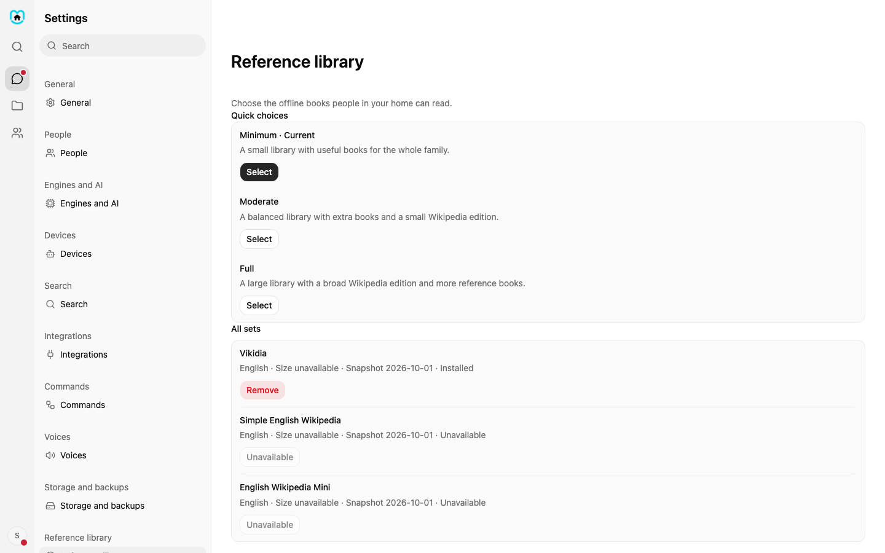
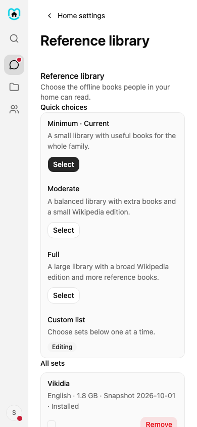

# Reference library

The Reference library stores books on your Home computer. People in your household can read those books even when the internet is down.

Only an owner or admin can change the library. Open **Settings**, choose **Search and web**, then open the **Reference library** tab. The Wikipedia app links straight to it. Children, teens, and other adults cannot open this page.

Books are grouped by topic: Encyclopedia, Dictionaries, Health and medicine, Travel and the world, and Books and how-to. Each Wikipedia choice says what you get. Everything with pictures is the biggest. Everything without pictures is smaller. Short introductions only is the smallest.

## Choose a starting set

At the top of the page, choose **Minimum**, **Moderate**, or **Full**. The current choice is marked. Home shows how much space the choice needs, how much space will be left, and an estimate of the download time. Choose **Use this list** to make it your Custom list. A choice that would leave too little drive space cannot be used. The message explains what to change.

## Change one book

Each row shows a book's language, size, snapshot date, and whether it is installed. Use the checkbox to add or remove it from your Custom list. Choose **Install** to see the space check before the download starts. Choose **Remove** to see how much space it frees and which age groups may lose access.

While a book downloads, Home shows its progress. Choose **Pause** to stop for now, **Resume** to keep going, or **Cancel** to stop the download.

Custom is only the list you edit. Home does not save it as another named preset.

## Pictures in answers

When you ask chat to show you something, Home looks in your offline books first. If a book has a page about it with pictures, those pictures come from your own computer and nothing goes online. Home checks every book you can read, not only Wikipedia.

Not every set has pictures. Vikidia and Simple Wikipedia now install with pictures, which adds about 3 GB. English Wikipedia is the exception: the small set has no pictures, and the full set with pictures is about 127 GB. Choose it only if you have the space. A book you installed earlier without pictures still works for text. Install the picture version to get its pictures.

Children see pictures only from the kids' books. Teens and adults see them from every book they can read. If the books have too few pictures, Home fills the rest from the internet as before.

## If something goes wrong

If Home cannot check the catalogue or drive space, check that Home is online and try again. If a download fails, open this page again to check its state. Ask the owner or admin to check the drive if there is not enough space.
