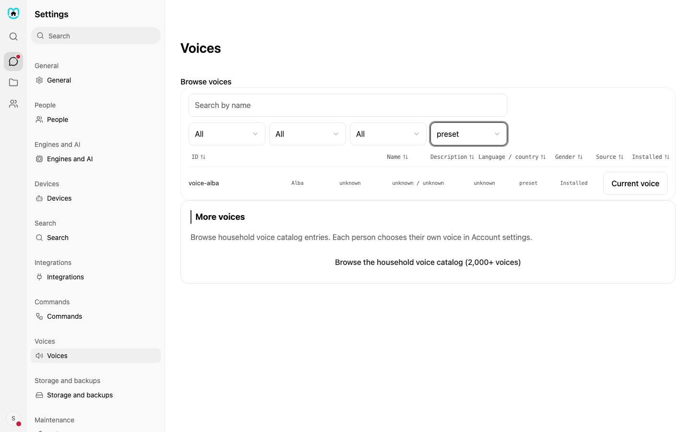
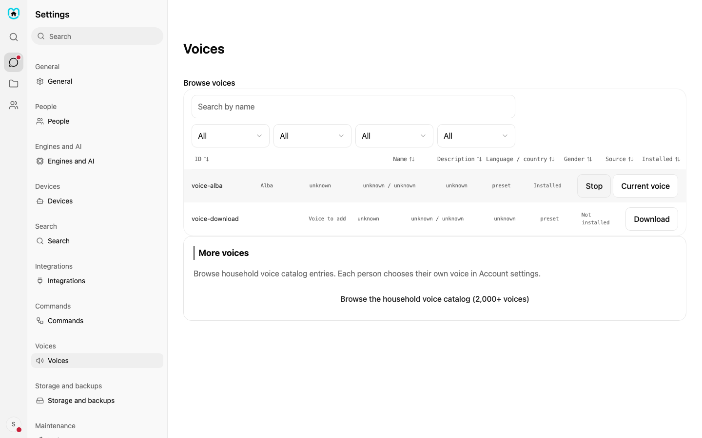
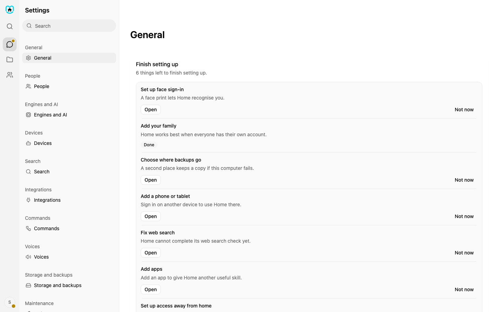

Settings are split into two tabs at the top of the page. **Household** holds shared settings, usually owner or admin only. **Me** holds your own personal preferences.

## Household settings

- **System**: your household's language and region. Also how long backups and conversation history are kept.
- **AI model tuning**, **Integrations**, **Notifications**, **Hugging Face token**: advanced options for MaiPai's models and connections.

Under **Manage**, open **Users** to add, edit, or remove household members; **AI models** to choose models; **Backups** to run or review backups; **Repairs** to check and fix issues; **Updates** to see what is available; and **Privacy** to review connections. See [People and parental controls](people.md) for account details.

## Clear saved online data

An owner or admin can open **Manage**, then **Storage**, to see saved copies Home fetched for weather, news, and other lookups. Clear one source or choose **Clear all**. This does not clear chats, memories, or items in the news shelf. Home fetches a cleared copy again the next time someone asks. If a service is taking a break, Home may wait before trying it again.

## Your own settings

Switch to the **Me** tab for your own personal preferences:

- **Appearance**, **Personality**, **Voice**: how MaiPai looks and sounds when it talks to you.
- **Look**: pick the color scheme of the whole app. Neutral is the standard look, black and white, the same as the design it comes from. Navy is MaiPai's own blue-black set. The other six are ready-made color sets (Stone, Zinc, Mauve, Olive, Mist, Taupe). Light and dark mode both follow whichever one you pick.
- **On this device only**: choose a light, dark, or system appearance for this browser. This device choice takes precedence over your personal Appearance setting; reset it to use your personal setting again. It is stored only in this browser and is not synced.
- **My notifications**: how you're notified. This includes linking your own Telegram chat.
- **Voices**: browse and pick a speaking voice, or clone your own.
- **PIN / password**: change how you sign in.
- **Your name**: change the name MaiPai calls you. It shows on your messages everywhere.
- **Commands**: teach MaiPai a phrase of your own. For example, "when I say movie night, dim the lights."
- **Devices & sessions**: see what's signed in as you. Sign out anything you don't recognize.

## Voices

Open **Settings**, choose the **Me** tab, then choose **Voices**. The page shows up to six voice choices at the top. Below them, the table lists voices Home can use. Each row shows the name, a short description, language, country, gender, source, and whether the voice is installed here.

Use the language, country, gender, and source filters to narrow the list. Use **Search by name** to find a voice. Choose **All** to clear a filter. Some details may say "unknown" when they are not known. Those voices still work.

Choose **Play** to hear one short sentence in a voice. Choose **Stop**, or play a different voice, to stop it. Home keeps the sound, so playing that voice again is quicker.

If a voice says **Not installed**, it is not on this home yet. An owner or admin can choose **Download**. The first download can take a little while. Home fetches the voice file once from its public source, then saves and speaks it on this home's own disk. If you do not see **Download**, ask the person who manages Home to add the voice.

Choose **Use this voice** on an installed preset voice to make it yours. The row then says **Current voice**. Home uses that voice when it talks to you in chat and when it reads text aloud.

Children see a shorter list and cannot change their own voice. If you are a child, ask a parent to choose your voice. An owner or admin can open **Voices**, use **Choosing a voice for**, and choose a child. Then choose **Use this voice** on an installed preset voice. Teens and adults choose their own voice. No one else can change it for them.

If Home shows "Home could not prepare this voice preview. Open Settings, then Engines, and check the voice setup.", an owner or admin can open **Settings**, then **Engines**, and check the voice setup. Everyone else can ask the person who manages Home to check it.

## Find a setting fast

Use the **Search settings** box at the top of the page. It jumps you straight to what you're looking for.

## Still need help?

If a setting won't save, or you can't find one you expect, see [Fix a problem](fix-a-problem.md).
