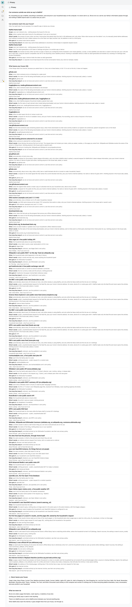
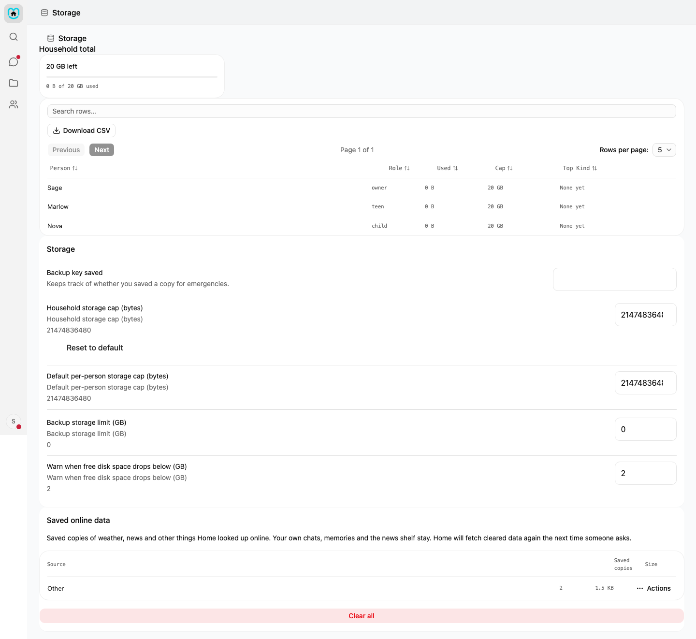

# What Home looks up for you

Home keeps your conversations here. Some features look up one small thing from a public service. This page lists those feature lookups. It does not list every connection. Open **Settings**, then **Privacy**, or read [Privacy](privacy.md) for the full list.

## How to see it live

Open **Settings**, then **Privacy**. This page lists the connections Home can make and what each one sends.

## Weather

**What it is for:** A weather answer for a place.

**When it happens:** Home asks Open-Meteo when someone asks about weather. About once an hour, it also refreshes the home place in the background. It skips this refresh if no home place is set.

**What it sends:** A weather request sends the place name you said to Open-Meteo. If your weather default is Current location, it sends your device's coordinates instead, rounded to about 1 km (about 10 km for a child). Home uses them for that one request and never stores them. The hourly refresh sends your saved home place. Choosing the home place on the Home page, with **Use my location** or a typed city, uses a list of cities built into Home. Nothing leaves your house for that step. Open-Meteo's geocoding service may also receive a place name.

**Who can use it:** Everyone. The package floor is child.

**How to clear what it saved:** Home keeps a saved answer for 30 minutes and may use it for up to one hour. An owner or admin can clear it in **Settings > Storage > Saved online data**. Home does not know how long Open-Meteo keeps its copy. See its own policy.

## News and news feeds

**What it is for:** Headlines from NPR or from the News shelf. The shelf can use feeds from many news sites. See the list in **News > Settings > News shelf**. It includes:
- 9to5Mac
- ABC News
- Al Jazeera
- Android Authority
- Ars Technica
- Business Insider
- CBC News
- CBS News
- CBS Sports
- CNBC
- CNET
- Daring Fireball
- Deadline
- Deutsche Welle
- Engadget
- Entrepreneur
- ESPN
- Fast Company
- Forbes
- Fortune
- Fox News
- France 24
- Gizmodo
- Grist
- Inc.
- Los Angeles Times
- MacRumors
- MarketWatch
- Mashable
- MIT Technology Review
- NASA
- Nature
- NBC News
- New Scientist
- NPR
- PBS
- Phys.org
- Popular Science
- Rolling Stone
- Science News Explores
- ScienceDaily
- Seeking Alpha
- Sky News
- Smithsonian
- Space.com
- Sports Illustrated
- Star Tribune
- TechCrunch
- TechRadar
- the BBC
- The Economist
- The Guardian
- The Hollywood Reporter
- The New York Times
- The Oregonian
- The Register
- The Texas Tribune
- The Verge
- The Wall Street Journal
- TIME for Kids
- Variety
- Tom's Guide
- Wired
- Yahoo Sports
- ZDNet

**When it happens:** With the shelf on, Home checks enabled feeds in the background about every 30 minutes, while nobody is using Home. With the shelf off, Home asks NPR when someone asks for news.

**What it sends:** Feed checks ask for a public feed file and include your home's internet address. They do not send a name, device ID, cookie, question or conversation. The live NPR request is a plain request with no personal details.

**Pictures and stories:** When someone's screen shows a news story, Home asks the publisher's picture server for that story's picture, once, and keeps a copy. While "Load News stories ahead of time" is on, Home also fetches the newest stories' pictures while nobody is using MaiPai, at most one per picture site every 30 seconds. That request is a plain request for the picture file the feed named and includes your home's internet address. Turn it off with **Pictures in News** in Settings. When someone opens a story, Home asks the publisher's site for that one page, once a day at most, and keeps the text. Both go through the same checks as any other page Home reads. Following topics, saving stories and what you have read never leave Home. When you open a story, Home asks the publisher's page for the article text. When a teen or an adult opens a page that is gone, Home asks the Internet Archive for a saved copy.

**Who can use it:** Everyone can ask for news. The news and child-feed packages start at child. The household-feed package starts at teen. Children read child feeds. Teens and adults read household feeds. Headlines for children and teens are checked before Home uses them.

**How to clear what it saved:** The live NPR answer stays for 15 minutes; an older answer may be used for up to one hour. An owner or admin can clear that saved answer in **Settings > Storage > Saved online data**. The shelf keeps headlines for the number of days set by **News retention** in Settings. News pictures are kept up to the size set by **News picture storage (MB)**, and a picture nobody has looked at for 14 days is removed. There is no clear button for the shelf. Turning the shelf off stops its use, but does not erase its saved headlines. They drop after the set number of days. See [The news shelf](news-shelf.md) for the retention setting and shelf switch. Home does not know how long feed publishers keep request records. See each publisher's policy.

## Sports

**What it is for:** Today's baseball schedule and scores.

**When it happens:** Home asks MLB when someone asks for sports scores.

**What it sends:** A plain request for today's schedule. It sends no personal details.

**Who can use it:** Everyone. The package floor is child.

**How to clear what it saved:** Home keeps the answer for five minutes and may use it for up to 15 minutes. An owner or admin can clear it in **Settings > Storage > Saved online data**. Home does not know how long MLB keeps its copy. See its own policy.

## Trivia

**What it is for:** A trivia question.

**When it happens:** Home asks the Open Trivia Database when a teen or adult asks for trivia. A child's question comes from a list stored at home.

**What it sends:** A plain request for one random question. It sends no personal details.

**Who can use it:** Everyone can ask. The package floor is child. Only teens and adults use the online source, and a teen's question is checked first. Children get a question from the home list.

**How to clear what it saved:** Home does not keep a saved answer for this lookup. There is nothing to clear here. Home does not know how long the Open Trivia Database keeps request records. See its policy.

## Jokes

**What it is for:** A random joke from icanhazdadjoke.com.

**When it happens:** Home asks when someone asks for a joke.

**What it sends:** A plain request for a random joke. It sends no personal details.

**Who can use it:** Everyone. The package floor is child.

**How to clear what it saved:** Home does not keep a saved answer for this lookup. There is nothing to clear here. Home does not know how long icanhazdadjoke.com keeps request records. See its policy.

## Currency

**What it is for:** Converting an amount between currencies using Frankfurter's rates.

**When it happens:** Home asks when someone asks to convert money.

**What it sends:** The two currency codes and the amount. It sends no other personal details.

**Who can use it:** Everyone. The package floor is child.

**How to clear what it saved:** Home keeps the answer for one hour and may use it for up to one day. An owner or admin can clear it in **Settings > Storage > Saved online data**. Home does not know how long Frankfurter keeps request records. See its own policy.

## Book lookup

**What it is for:** Finding a book by its title or author.

**When it happens:** Home asks the Library of Congress after a teen or adult asks about a book.

**What it sends:** The title or author as you said it.

**Who can use it:** Teens and adults. The package floor is teen.

**How to clear what it saved:** Home keeps the answer for one day and may use it for one more day. An owner or admin can clear it in **Settings > Storage > Saved online data**. Home does not know how long the Library of Congress keeps request records. See its own policy.

## Place lookup

**What it is for:** Finding a named place, such as a park or landmark.

**When it happens:** Home asks OpenStreetMap Nominatim after a teen or adult asks about a place.

**What it sends:** The place name as you said it.

**Who can use it:** Teens and adults. The package floor is teen.

**How to clear what it saved:** Home keeps the answer for seven days and may use it for seven more days. An owner or admin can clear it in **Settings > Storage > Saved online data**. Home does not know how long OpenStreetMap Nominatim keeps request records. See its own policy.

## Music

**What it is for:** Looking up facts about a music artist.

**When it happens:** Home asks MusicBrainz when someone asks about an artist.

**What it sends:** The artist's name. It sends no other personal details.

**Who can use it:** Everyone. The package floor is child.

**How to clear what it saved:** Home keeps the answer for one day and may use it for up to seven days. An owner or admin can clear it in **Settings > Storage > Saved online data**. Home does not know how long MusicBrainz keeps request records. See its own policy.

## Film and TV lookup

**What it is for:** Looking up a film or show's director, cast, length, rating or release date.

**When it happens:** Home asks Wikidata when someone asks about a film or show. If it finds a match, Home asks Wikipedia for a short summary.

**What it sends:** The film or show title goes to Wikidata. A release year goes too if one was given. Wikipedia gets the page title found by Wikidata, not the words you typed.

**Who can use it:** Everyone. The package floor is child.

**How to clear what it saved:** Home keeps the answer for one day and may use it for up to seven days. An owner or admin can clear it in **Settings > Storage > Saved online data**. Home does not know how long the Wikimedia Foundation keeps request records. See its own policy.

## Pictures

**What it is for:** Adding pictures to a written answer about a well-known thing.

**When it happens:** In a normal written answer for an adult, when it is about something you can look at and pictures are on. Home skips pictures for spoken answers, glances and temporary chats.

**What it sends:** Wikidata, Wikipedia and Wikimedia Commons get the name of the thing. A picture site gets a plain picture request with no cookie or page address. For other things, your own SearXNG server may get the name.

**Who can use it:** Only adults can use pictures. The package floor is child, but Home offers this feature to adults only. The adult must have pictures turned on.

**How to clear what it saved:** Home does not keep picture files in **Saved online data**. The picture link stays with the chat answer. Delete the chat from the chat list to remove that answer. The picture sites and your SearXNG server set how long they keep their own copies.

## This day in history

**What it is for:** A short list of events that happened on this day.

**When it happens:** Home asks Wikipedia when someone asks what happened on this day in history.

**What it sends:** Today's month and day. It does not send anything typed by your family.

**Who can use it:** Everyone. The package floor is child.

**How to clear what it saved:** Home keeps the answer for 12 hours and may use it for up to one day. An owner or admin can clear it in **Settings > Storage > Saved online data**. Home does not know how long the Wikimedia Foundation keeps request records. See its own policy.

## Sun and moon

**What it is for:** Finding the moon phase, or when the sun rises and sets.

**When it happens:** Home works out the moon phase from the date. Sunrise and sunset use the date and the home's saved place. Moon phase works without a home place.

**What it sends:** Nothing. These answers are worked out on this computer.

**Who can use it:** Everyone. The package floor is child.

**How to clear what it saved:** This lookup makes no online request and saves no online answer, so there is nothing to clear in **Saved online data**.

## Web search

**What it is for:** Searching the live web, reading a page, looking up one word online, or finding a saved copy of a missing page.

**When it happens:** Someone presses Enter on the **Web** tab of the Search box. Home sends that one search to the same sources, and nothing is sent while someone types. If SearXNG is the chosen source, Home sends a search to your SearXNG server. If DuckDuckGo is on (it is on for adults when SearXNG is not set up), an adult's search also goes to DuckDuckGo from a small search service on your computer. It may read up to three pages from results. It fetches a page you ask it to explain or link to. It asks Wiktionary only when an adult looks up one word, the home dictionary has no answer, and **Look up words online** is on. It asks Wikipedia only for an adult search with no result and no match in the home library. It asks the Wayback Machine only for a missing page in a teen or adult search. Children never use those three fallbacks. They also stay off in **Library only** mode.

**What it sends:** The SearXNG source gets your search words and sends them to its chosen search engines. DuckDuckGo gets the same words and your home's internet address, and nothing else. If an adult has added a Brave key, adult searches also go to Brave. Children and teens do not use Brave. A page site gets a normal request for its page, not your search. Wiktionary gets one word. Wikipedia gets the search words. Wayback gets the missing page's address. These sites also see your home's internet address.

**Who can use it:** Everyone. The package floor is child. Children and teens use SearXNG only, unless an owner or admin turns on **DuckDuckGo for teens and children** in **Settings > Search**. They do not use Wikipedia fallback, Wiktionary or Wayback.

**How to clear what it saved:** Home keeps page copies for up to one week, or one day for a news page. In **Settings > Search**, set **Search fetch cache limit (GB)** to 0 to stop saving pages. Old copies are removed by the daily cleanup. See [Set up web search](web-search.md) for this setting. SearXNG and the other sites set how long they keep their own records. Web search needs no key or account.

## Clearing everything

An owner or admin can open **Settings > Storage** and find **Saved online data**. Choose **Clear <source>** for one source, or **Clear all** for all saved online data. The **Clear all saved online data?** message asks you to confirm. These buttons clear saved copies in this list. They do not clear your chats, memories, the news shelf or saved web pages.

## What never happens

- Your conversations stay on this computer.
- Home does not collect usage stats or crash reports.
- Nothing your family says is used to train anything.
- A MaiPai server is not in the path.

Children and teens have the limits shown above. Read [Sensitive subjects](sensitive-subjects.md) and [People and parental controls](people.md) to learn more.
